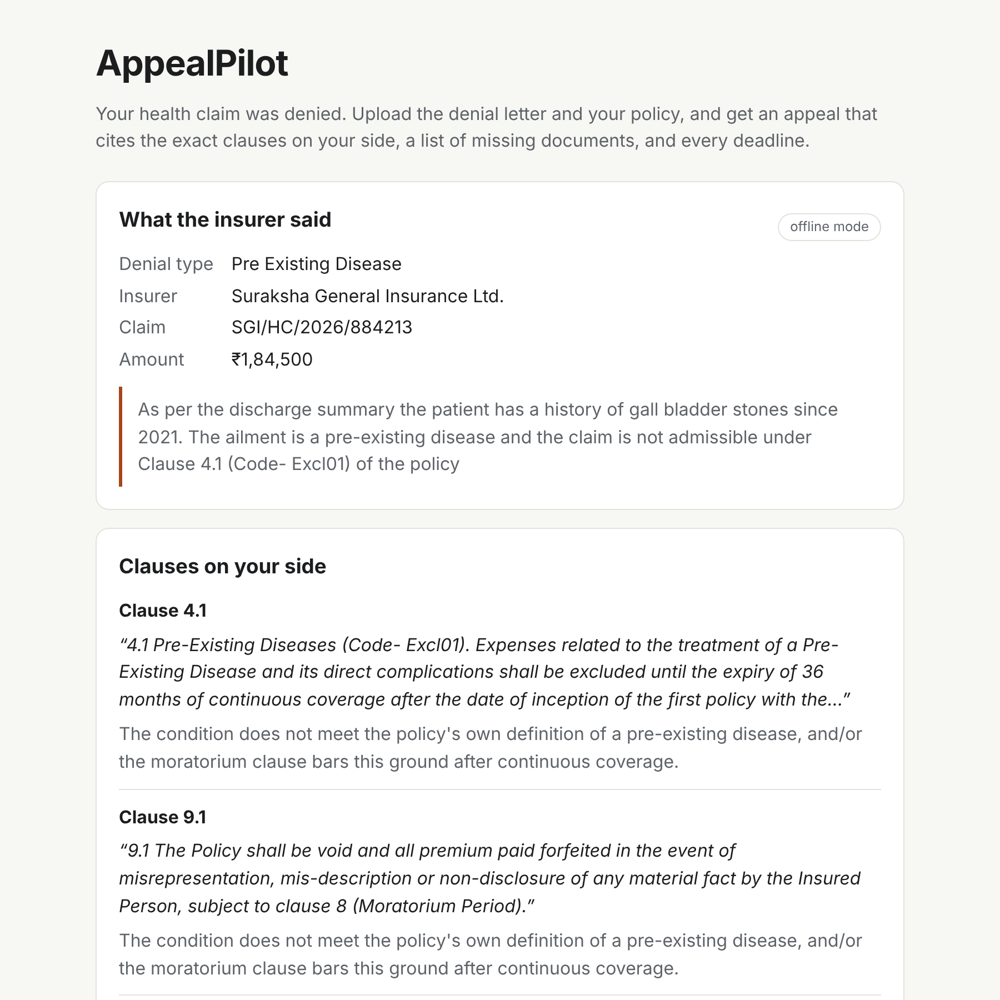
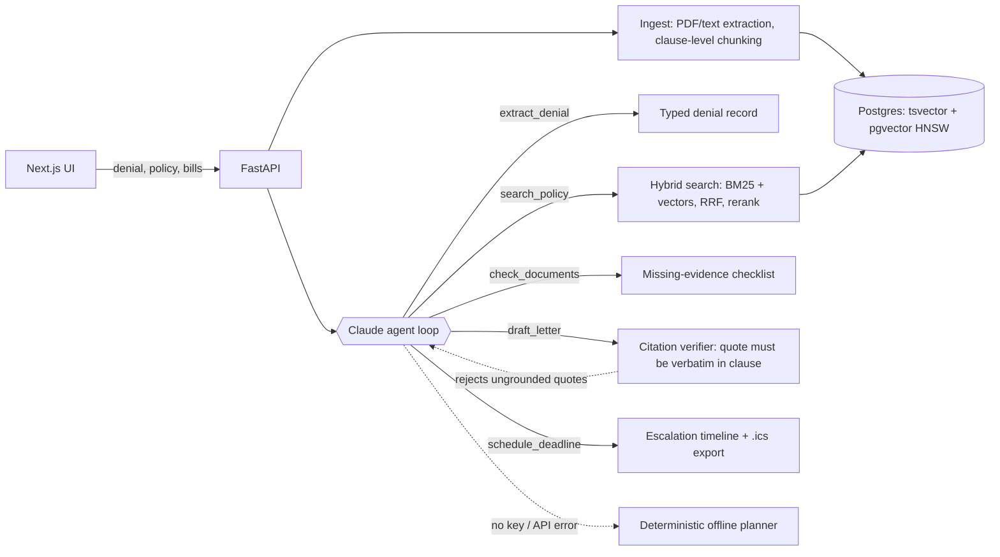
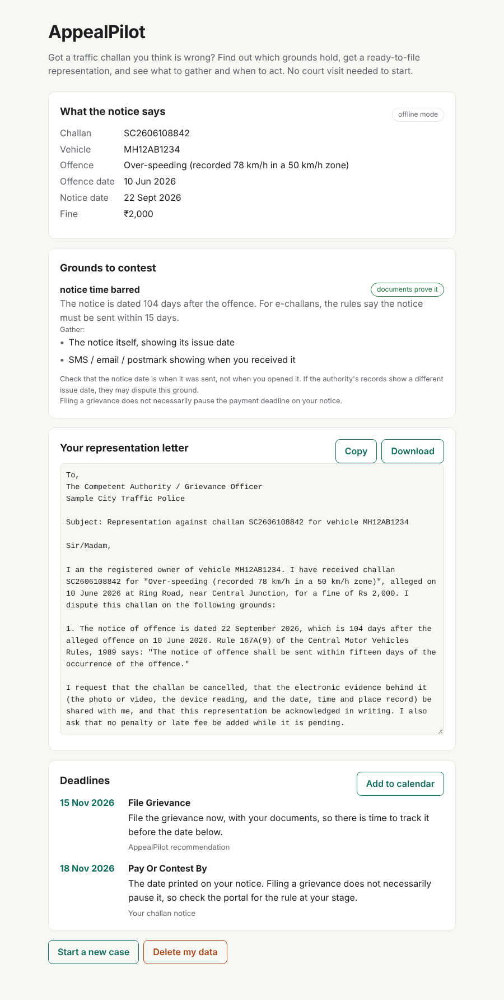

# AppealPilot

**An AI copilot for appeals people usually give up on.** Two case types today: denied health-insurance claims and traffic challans. For insurance: upload the denial letter and your policy wording. AppealPilot finds the clauses that contradict the denial, checks which documents are missing, drafts an appeal letter whose citations are verified against the policy text, and lays out every escalation deadline (insurer grievance, then Insurance Ombudsman).

Built for India first. Most people accept a rejected claim because writing a good appeal means reading a 40-page policy, matching it to bills and discharge summaries, citing the right clause and hitting the right deadlines. That is a specialist's job today. AppealPilot makes it a ten-minute one.



## How it works



1. **Clause-level ingestion.** Policy wordings are split on their own numbering (`4.1`, `6.2`) so an appeal cites "Clause 4.1", not "chunk 17". Scanned PDFs with no text layer go to Claude as PDF documents so vision can read them.
2. **Hybrid retrieval.** Denial letters quote exact wording ("Code- Excl03"), which keyword search nails, while people paraphrase ("my knee surgery waiting time"), which vectors handle. AppealPilot runs both, fuses them with Reciprocal Rank Fusion, boosts a clause the insurer cited by number, and demotes definitions that match everything. Postgres full-text plus pgvector in production; a pure-Python BM25 and in-memory index for tests.
3. **An agent with five typed tools.** Claude (`claude-opus-5-5` by default) drives `extract_denial`, `search_policy`, `check_documents`, `draft_letter` and `schedule_deadline` through the Messages API tool-use loop. Tool schemas are `strict`, so arguments always validate.
4. **Citations that can't be invented.** `draft_letter` rejects any citation whose quote is not verbatim in a clause the agent actually retrieved. The error goes back to the model as a tool result and it fixes the letter. A test plays this back with a scripted model.
5. **Graceful degradation.** With no API key, or if the API fails mid-case, a deterministic planner fills every missing step, so the user always gets a letter and a timeline. The same planner is the baseline the agent has to beat in the eval.
6. **Safety and privacy.** Documents are fenced as untrusted data in the prompt (prompt-injection defence). The agent can search and draft but cannot send anything; a person files the appeal. Logs and traces pass through PII redaction (Aadhaar, PAN, phone, email, policy numbers). Every case has a delete-my-data endpoint and button.

## Traffic challans

Most people just pay a challan they think is wrong, because contesting feels like a day in court. AppealPilot's challan flow works from the notice:

1. **Reads the notice** (text, PDF or a phone photo, which Claude reads with vision) and merges it with the dates the user enters, which win over anything parsed.
2. **Checks grounds.** A ground is **strong** only when the documents prove it by themselves. Today that is one thing: an e-challan whose notice is dated more than 15 days after the offence (Rule 167A(9), Central Motor Vehicles Rules, 1989, as cited in the [Kerala High Court report](https://www.livelaw.in/amp/high-court/kerala-high-court/kerala-high-court-e-challans-speeding-issued-beyond-statutory-time-period-plea-231154) and the [Ministry notification coverage](https://www.businesstoday.in/latest/politics/story/traffic-offenders-to-get-e-challan-in-15-days-as-govt-tightens-rules-304567-2021-08-19)). Everything else the user raises (wrong vehicle, cloned plate, already sold, already paid, no notice, incomplete notice, no signage) is **possible**: it holds only with the user's own evidence, and the app lists exactly what to gather. A user's claim is never upgraded to strong.
3. **Drafts a representation** to the traffic authority. Only text quoted word for word from the rule can be cited; process guidance is kept in a separate `guide:` corpus that the verifier refuses to cite as law.
4. **Builds a timeline from the date printed on the notice.** The pay-or-contest window differs by authority and stage, and I could not confirm a single national number from primary text, so the app never invents one. It also warns that filing a grievance does not necessarily pause payment.



The challan flow uses the same tool-use loop, hybrid search over the bundled rule text, offline fallback, PII redaction (vehicle numbers included) and delete-my-data as the insurance flow.

## Evaluation

`backend/evals/` holds labelled denial cases: the denial letter, the expected denial type, and the clauses a strong appeal must cite (for example a moratorium clause against a non-disclosure denial, or the proportionate-deduction carve-out against a room-rent deduction on medicines).

| Split | Cases | What it tests |
| --- | --- | --- |
| `dev` | 20 | Main sample policy. The offline rules were developed against this split. |
| `heldout` | 6 | A second policy with different wording and numbering, never tuned against. |

Offline baseline (no LLM, free, gated in CI):

| Split | Category accuracy | Recall@5 | Appeal cites a gold clause | Citations grounded |
| --- | --- | --- | --- | --- |
| dev | 1.00 | 1.00 | 1.00 | 1.00 |
| heldout | 0.83 | 0.67 | 0.67 | 1.00 |

The drop on the held-out policy is the point: keyword rules overfit to one insurer's phrasing, which is where the Claude agent earns its cost. Run `python evals/run_eval.py --mode claude --split heldout` with a key to get the agent's numbers, tokens, latency and cost per case (also runs in CI when the repo variable `RUN_CLAUDE_EVAL` is `true`). **Claude-mode numbers have not been measured yet**, so the figures above are the offline baseline only.

**Challan regression suite** (`python evals/run_challan_eval.py`, 12 cases): exact-match 1.00, no false "strong" grounds, citations grounded 1.00. Treat this as a regression test, not accuracy evidence: the labels follow the same rules the code implements, so it protects against breaking the 15-day logic and the strong/possible distinction, and says nothing yet about real-world notices. Real notices (with consent) are the next thing to test on.

The cases and policies are synthetic and small. Before claiming accuracy publicly, grow the set with real, anonymised denial letters (with consent) and report the held-out split.

## Quickstart

**Local, no Docker, no API key** (in-memory store, offline planner):

```bash
python -m venv .venv && . .venv/bin/activate
pip install -e "backend[dev]"
cd backend && uvicorn appealpilot.api:app --reload      # http://localhost:8000/docs
# in another terminal
cd frontend && npm install && npm run dev               # http://localhost:3000
```

Click **Try a sample case**. Add `ANTHROPIC_API_KEY` to `.env` to switch on the Claude agent.

**Full stack with Postgres + pgvector:**

```bash
cp .env.example .env          # optionally add ANTHROPIC_API_KEY
docker compose up --build     # web :3000, api :8000, db :5432
```

**Checks:**

```bash
cd backend
ruff check . && pytest -q
python evals/run_eval.py                 # dev split
python evals/run_eval.py --split heldout
```

## API

| Method | Path | What it does |
| --- | --- | --- |
| `POST` | `/api/cases` | Multipart: `policy` file, `denial` file or `denial_text`, optional `supporting` files. Returns the full case result. |
| `POST` | `/api/demo` | Runs the bundled sample case. |
| `GET` | `/api/cases/{id}` | Case result. |
| `GET` | `/api/cases/{id}/letter.txt` | Appeal letter as text. |
| `GET` | `/api/cases/{id}/deadlines.ics` | Deadlines as a calendar file. |
| `DELETE` | `/api/cases/{id}` | Deletes the case, its clauses and vectors. |
| `POST` | `/api/challans` | Multipart: `challan` file or `challan_text`, optional `offence_date`, `notice_date`, `pay_by`, `hearing_date`, `sold_date`, `vehicle_number`, `is_echallan`, `grounds` (repeat), `notes`, `supporting` files. |
| `POST` | `/api/demo/challan` | Runs the bundled sample e-challan. |
| `GET` | `/healthz` | Mode (`claude` / `offline`) and store type. |

## Project layout

```
backend/appealpilot/
  agent.py        Claude tool-use loop + offline fallback
  tools.py        five typed tools, strict schemas, citation verifier
  retrieval/      BM25, hashing embedder, RRF fusion, in-memory and pgvector stores
  ingest.py       PDF/text extraction, clause chunking
  offline.py      deterministic denial parser, query planner, letter template
  challan.py      challan parser, grounds check, letter, deadlines, Claude agent
  data/           rule extracts (citable) and process guidance (not citable)
  documents.py    required evidence per denial type
  deadlines.py    escalation timeline (one table, easy to update)
  redact.py       PII redaction for logs and traces
backend/evals/    labelled cases, held-out split, eval runner
frontend/app/     Next.js upload and results UI
samples/          fictional policy wordings, denial letter, discharge summary
```

## Deploying

- **API:** the backend image runs on Cloud Run as is (it reads `$PORT`). Use a managed Postgres with pgvector (Supabase, Neon or Cloud SQL) and set `DATABASE_URL`.
- **Web:** deploy `frontend/` to Vercel with `NEXT_PUBLIC_API_URL` pointing at the API.

## Roadmap

- Durable multi-week reminders (Inngest or Temporal) driven by the deadline table.
- Sign-in (Supabase Auth) and encrypted file storage.
- Tracing (Langfuse or OpenTelemetry) and Sentry.
- A hosted embedding model (for example Voyage AI) behind the existing `Embedder` interface.
- State-specific eChallan and virtual-court flows, and a confirmed national pay-or-contest window once checked against the Gazette text.
- More challan grounds that documents can prove (for example a missing Section 65B certificate on the notice) once verified.
- Letters in Hindi and other Indian languages; Ombudsman complaint form pre-fill.
- A real-world eval set and a success-rate study with early users.

## Limits

The day counts in `deadlines.py` follow the Insurance Ombudsman Rules, 2017 and IRDAI's policyholder-protection rules as summarised by the [Council for Insurance Ombudsmen](https://cioins.co.in/). Check them against the current official text before relying on them. The challan rules are summarised from news and legal-news coverage, not the Gazette: check [the Rule 167A text](https://www.livelaw.in/amp/high-court/kerala-high-court/kerala-high-court-e-challans-speeding-issued-beyond-statutory-time-period-plea-231154) before filing. The process guidance comes from public explainers ([Autocar India](https://www.autocarindia.com/auto-features-amp/how-to-dispute-a-wrong-e-challan-441225), [Spinny](https://www.spinny.com/blog/virtual-court-challan-how-to-check-pay-or-contest-traffic-challans-step-by-step/), [Odisha TV](https://odishatv.in/news/national/traffic-e-challans-to-be-issued-within-15-days-check-new-notification-157869)). AppealPilot gives information, not legal advice, and the sample policies and notices are fictional.

## Resume bullet

> Built AppealPilot, an agentic copilot for denied health-insurance claims (FastAPI, Next.js, Claude tool use, Postgres + pgvector hybrid RAG): five typed tools, a citation verifier that rejects any quote not verbatim in the policy, and an offline fallback; 100% recall@5 on a 20-case dev set and a held-out policy split that exposes keyword overfitting, gated in CI.

Replace the numbers with the Claude-mode held-out results and real user outcomes as you collect them.

## License

MIT
